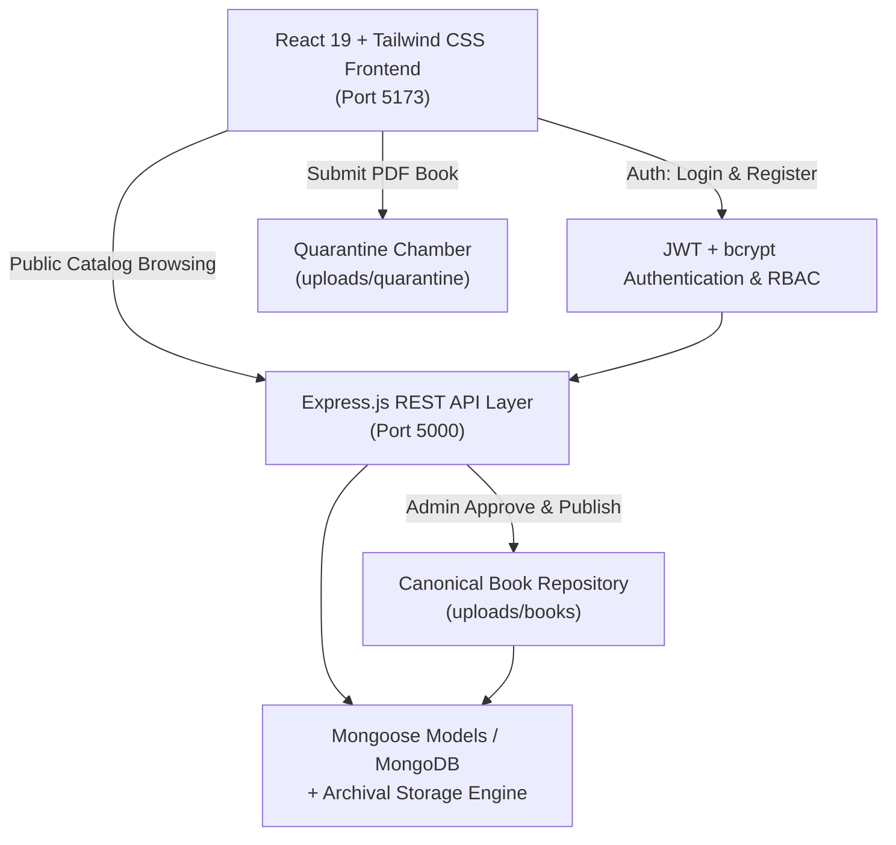

# NovelShelf — Full MERN Stack Digital Library & Archival Sanctuary

## 🌐 Live Demo

Visit the live deployed application here: [NovelShelf Live](https://mynovelshelf.netlify.app/)

A production-grade digital sanctuary featuring a curated book catalogue, tranquil online Reading Room, secure PDF manuscript quarantine workflow, user authentication, and a comprehensive master admini[...]

---

## 🏛️ System Architecture



---

## 🔑 Default Accounts (Quick Test)

| Role | Email | Password | Permissions |
|---|---|---|---|
| **Master Archivist (Admin)** | `admin@novelshelf.com` | `Admin@123456` | Full Admin Dashboard, Book CRUD, Manuscript Review, Categories, Users, Audit Logs |
| **Patron (Reader)** | `patron@novelshelf.com` | `User@123456` | Reading Room access, Progress synchronization, Bookmarks, PDF Contribution upload |

> **Note:** The Login page (`/login`) also includes a **"Quick Demo Accounts"** one-click autofill bar for instantaneous testing.

---

## 🚀 Getting Started

### 1. Prerequisites
- **Node.js** (v18+)
- **NPM** (v9+)
- *(Optional)* **MongoDB** (If local MongoDB or MongoDB Atlas URI is set in `backend/.env`, it connects automatically; if offline, an integrated persistent archival engine seamlessly stores data witho[...] 

### 2. Running the Backend
```bash
cd backend
npm install
npm start
```
- Server running at: `http://localhost:5000`
- API Health Check: `http://localhost:5000/api/v1/health`

### 3. Running the Frontend
```bash
cd frontend
npm install
npm run dev
```
- Web Application running at: `http://localhost:5173`

---

## 🛡️ Core Features & Workflows

### 1. Public Catalogue (No Login Required)
- Any visitor can browse canonical works, search by title/author/genre, explore categories, and view complete book folios.

### 2. Reading Room Protection
- Clicking **"Start Reading in Sanctuary"** or visiting `/reader/:bookId` strictly requires patron authentication.
- Unauthenticated guests are automatically redirected to `/login?redirect=...` and returned directly to the book upon logging in.
- Reading progress (current page, spread index, chapter) and bookmarks are synced to the backend API (`/api/v1/reading/*`).

### 3. Digital Manuscript Contribution & Quarantine
- Authenticated patrons can contribute books with legal copyright/public domain confirmation (`/contribute`).
- Uploaded PDFs are stored in an isolated **quarantine chamber** (`backend/uploads/quarantine/`) and marked `under_review`.
- Files remain strictly private and quarantined until an archivist inspects and approves them.

### 4. Professional Admin Dashboard (`/admin`)
Accessible only to users with the `admin` role:
- **Dashboard Overview (`/admin`)**: Real-time metrics on published books, active patrons, pending review manuscripts, and recent platform events.
- **Book Management (`/admin/books`)**: Full CRUD operations—catalog new books with PDF uploads and cover images, edit metadata, toggle visibility (`published` vs `draft`), and decommission volumes.
- **Category Organization (`/admin/categories`)**: Create, edit, and organize shelf alcoves with live book counters and icons.
- **Manuscript Review Queue (`/admin/contributions`)**: Inspect submitted PDFs, review patron metadata, and either **"Approve & Publish to Public Shelves"** (automatically moves file from quarantine t[...]
- **Patron & User Management (`/admin/users`)**: Search patrons, promote/demote between `user` and `admin`, and suspend or reactivate accounts.
- **Audit & Activity Log (`/admin/logs`)**: Complete immutable ledger tracking all logins, registrations, contributions, reviews, publications, and administrative actions.

---

## 📡 API Endpoints Summary

### Authentication (`/api/v1/auth`)
- `POST /register` — Register new patron account
- `POST /login` — Authenticate and receive JWT token
- `GET /me` — Get current patron profile
- `PUT /profile` — Update name, bio, or avatar
- `POST /logout` — Invalidate session

### Books & Catalogue (`/api/v1/books`)
- `GET /` — Browse public catalog (supports search, category, genre, era filters)
- `GET /:id` — Get volume metadata by slug or ID
- `GET /:id/content` — Stream book PDF / read spreads *(Protected — requires auth)*

### Categories (`/api/v1/categories`)
- `GET /` — List all active alcoves with live folio counts

### Reading Room (`/api/v1/reading`)
- `GET /progress/:bookId` — Fetch saved progress *(Protected)*
- `POST /progress/:bookId` — Synchronize current reading page *(Protected)*
- `GET /bookmarks` — Fetch bookmarks *(Protected)*
- `POST /bookmarks` — Add archival ribbon bookmark *(Protected)*
- `DELETE /bookmarks/:bookId/:page` — Remove bookmark *(Protected)*

### Patron Contributions (`/api/v1/contributions`)
- `POST /` — Upload manuscript PDF to quarantine *(Protected)*
- `GET /my` — List patron's submitted contributions *(Protected)*
- `GET /:id/pdf` — Stream quarantined PDF for inspection *(Protected)*

### Admin Management (`/api/v1/admin`) — *(Admin Only)*
- `GET /dashboard` — Platform analytics & metrics
- `GET /books` — Full book list
- `POST /books` — Catalog new volume with PDF attachment
- `PUT /books/:id` — Update volume metadata / PDF
- `DELETE /books/:id` — Remove volume
- `POST /categories` — Add new category
- `PUT /categories/:id` — Edit category
- `DELETE /categories/:id` — Delete category
- `GET /contributions` — Review queue
- `POST /contributions/:id/review` — Approve/Reject manuscript
- `GET /users` — Patron management list
- `PATCH /users/:id/role` — Update role (`user` / `admin`)
- `PATCH /users/:id/status` — Update status (`active` / `suspended`)
- `GET /logs` — Archival audit log trail

